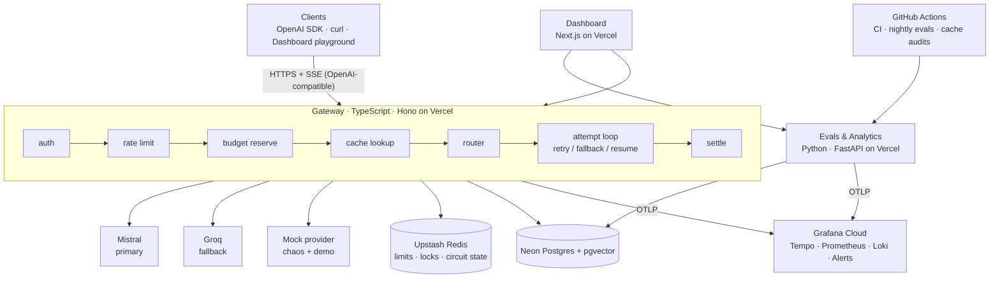

# Switchboard Roadmap

> An LLM gateway: a streaming, OpenAI-compatible proxy with provider fallbacks, retries,
> semantic caching and cost tracking per key, plus a Python service for evals and analytics,
> and OpenTelemetry GenAI tracing with budget alerts.

**Timeline:** 6 weeks × ~20 hrs/week (~120 hrs)
**Target roles:** Backend / distributed systems · Platform / DevOps / SRE · AI / LLM engineer · Full-stack
**Budget:** $0 (free tiers only: Vercel Hobby, Mistral free API plan, Groq free tier, Neon, Upstash, Grafana Cloud, GitHub Actions)

---

## 1. Architecture



### Domains

| Domain | Service |
|---|---|
| `switchboard.temwa.dev` | Dashboard |
| `api.switchboard.temwa.dev` | Gateway |
| `evals.switchboard.temwa.dev` | Evals & analytics (accepts internal requests only) |

### Repo layout

One repo for everything: pnpm workspaces + Turborepo, with uv for Python.

```
apps/gateway        Hono API, OpenAI-compatible, provider adapters
apps/dashboard      Next.js App Router + shadcn/ui + Auth.js (GitHub login)
apps/mock-provider  OpenAI-compatible server that fails on command
services/evals      FastAPI, Pydantic v2, SQLAlchemy 2, Alembic, polars
packages/core       shared types, OpenAPI spec, pricing, SSE parser
packages/db         Drizzle schema + migrations (gateway schema)
infra/terraform     Vercel, Neon, Upstash, Grafana as code
infra/docker        docker-compose: pgvector, redis, grafana/otel-lgtm, mock
docs/               design doc, ADRs, diagrams, runbooks, SLOs, postmortem
load/               k6 scripts
```

---

## 2. The two hard parts

### A. Streaming through retries and fallbacks

- **Adapter pattern:** each provider adapter converts that provider's stream into one internal event stream. The event types are `start`, `delta`, `usage`, `finish` and `error`. The gateway sends clients only OpenAI-format SSE.
- **Error classifier:**
  - Retry or fall back on 429 (respecting `Retry-After`), 5xx, network resets, a timeout before the first token, or a stall between tokens.
  - Never retry 400, 401 or content-filter errors.
- **Retry policy:**
  - Exponential backoff with full jitter.
  - A **retry budget**: retries may be at most ~10% of traffic, which prevents retry storms.
  - Three deadlines: time to first token, stall between tokens, and total request time.
- **Circuit breaker for each provider**, with its state kept in Redis. It moves between closed, open and half-open.
- **The key rule:** until the first byte reaches the client, every failure can be retried invisibly. After tokens have been sent, each key chooses a policy:
  - `abort`: send a final SSE error event and stop.
  - `resume`: send the partial answer to the next attempt so it continues from there. Mistral supports this directly through a `prefix` assistant message; other providers fall back to a "continue" prompt. Remove any overlapping text, mark the response `x-switchboard-resumed: true`, and record the fact in the final event.
- **Client disconnects:** when the client disconnects, an `AbortController` cancels the upstream request, so you stop paying for tokens nobody will read.
- **Billing across attempts:** every attempt is billed, including partial failed ones, because providers charge for them.

### B. Cache correctness

- **Exact cache:** the key is a SHA-256 hash of a *canonicalized* request. Canonicalizing means sorting JSON keys and normalizing defaults. The hash covers:
  - model, messages, temperature, top_p, max_tokens, seed and response_format
  - a hash of the tool schema
  - a cache-key version
- **Semantic cache:** stored in pgvector using `mistral-embed` (1024 dimensions). A lookup only matches inside the same scope: same tenant, same model, same system prompt hash, same tool hash and same hash of the earlier conversation. Only the last user turn is compared by meaning. This is how you avoid answering one user with another user's context.
- **What gets written to the cache:** only completed, successful, unresumed responses with `finish_reason=stop`. Nothing is cached when:
  - the request includes tool calls
  - temperature is above a configured limit (unless the key opts in)
  - the request sends `Cache-Control: no-store`
- **Stampede protection:** when identical requests arrive at the same time, a Redis lock lets one of them call the provider while the others wait for its result (single-flight).
- **Replaying a hit:** the cached answer is streamed back as SSE, and the `x-switchboard-cache` header reports `hit-exact`, `hit-semantic`, `miss` or `bypass`, plus the similarity score.
- **Invalidation:** the embedding model version and the cache-key version are both part of the key, so changing either one invalidates old entries.
- **Proving it's correct:** the Python service samples semantic hits, asks for a fresh answer, and has an LLM judge decide whether the cached answer was still right. That gives a false-positive rate, and a plotted curve used to *choose* the similarity threshold.

---

## 3. Other features

| Area | What to build |
|---|---|
| **API keys** | Format `sb_live_…`, stored hashed and compared in constant time, shown only once, can be revoked, scoped to an org |
| **Rate limits** | Requests per minute and tokens per minute, as a token bucket in a Redis Lua script (one round trip) |
| **Cost** | Money stored as integer micro-dollars, never floats. Prices kept in a versioned table with `effective_from`, and each request saves the price it was charged at. |
| **Budgets** | Before calling a provider, reserve the most the request could cost; after it finishes, record the actual cost. Hard limit returns `402`; a soft limit only warns. |
| **Alerts** | At 50%, 80% and 100% of a budget, send a Discord webhook exactly once (deduplicated with `SETNX`), and also run Grafana burn-rate alerts |
| **Python evals** | Datasets; judges (exact match, regex, JSON schema, embedding similarity, LLM-as-judge); eval runs sent through the gateway itself; a regression gate in CI |
| **Python analytics** | Cost per key/model/day; p50 and p95 latency and time to first token per provider; fallback rate; cache savings |
| **OpenTelemetry** | GenAI semantic-convention spans, pinned to one spec version. Example attributes: `gen_ai.operation.name`, `gen_ai.request.model`, `gen_ai.usage.input_tokens`, `gen_ai.response.finish_reasons`. Custom attributes such as `switchboard.attempt`, `.cache.result`, `.fallback.reason` and `.cost_usd_micros`. Pass trace context into the Python service. Flush spans with `waitUntil`, because a serverless function can stop before spans are sent. |
| **Dashboard** | Overview, Keys, Requests (each one links to its trace), Evals (with the threshold curve), Provider health (circuit breaker states), and the Playground |
| **Playground** | Switches such as "drop stream at token 20", "429 storm" and "slow first token". A live timeline shows each attempt as it happens. |

---

## 4. Data model

**`gateway` schema, owned by Drizzle:**
- `orgs`, `users`, `memberships`
- `api_keys`: budget, limits and policy columns
- `providers`, `models`, `model_prices`
- `routes`: the fallback chain
- `requests` and `attempts`: one request has many attempts
- `usage_hourly`, `budget_alerts`
- `cache_entries`: includes a `vector(1024)` column

**`evals` schema, owned by Alembic:**
- `datasets`, `dataset_items`, `eval_runs`, `eval_results`, `cache_audits`

The Python service gets read-only access to views of the gateway schema; each service owns its own schema.

**Free-tier limits:** delete request bodies after 7 days, cut down very long prompts, and keep Redis calls per request low.

---

## 5. Documentation

### Diagrams

1. **C4 level 1:** system context
2. **C4 level 2:** containers
3. **C4 level 3:** gateway components
4. **UML class diagram:** the provider adapter interface and its implementations
5. **Sequence diagrams:**
   - happy-path stream
   - failure in the middle of a stream, then resume on the fallback provider
   - semantic cache hit
   - budget reserve and settle
   - stampede (single-flight)
6. **State machines:**
   - the life of one attempt
   - the circuit breaker
7. **Activity diagram:** routing decision
8. **Entity-relationship diagram**
9. **Data flow diagram with trust boundaries:** feeds a STRIDE threat model
10. **Deployment diagram:** Vercel, Neon, Upstash, Grafana Cloud and GitHub Actions
11. **CI/CD pipeline diagram**
12. **Real trace waterfall:** a screenshot from Grafana

Use Mermaid (renders on GitHub) and optionally Structurizr DSL for the C4 diagrams.

### Decision records (ADRs, MADR format)

1. Monorepo tooling (pnpm + Turborepo + uv)
2. Hono on the Node.js runtime
3. OpenAI-compatible API
4. Mid-stream failure policy (resume vs abort)
5. Semantic cache scoping and thresholds
6. Money as integer micro-dollars
7. Budget enforcement through reservations
8. Schema ownership per service
9. GitHub Actions as the job scheduler (Vercel Hobby only runs scheduled jobs once a day)
10. Pinning the OpenTelemetry GenAI spec version

### Operations documents

- SLOs, for example 99.5% availability and p95 time to first token, with burn-rate alerts
- Runbooks: provider down, budget alert firing, cache false-positive spike
- Game day write-up and a real postmortem of a bug it exposes

---

## 6. Testing and DevOps

### Tests

- **Unit tests:** canonicalization, the error classifier, backoff, cost math, the SSE parser.
- **Property-based tests:** fast-check (TypeScript) and Hypothesis (Python). For example: a cache key must not change when JSON key order changes, and must change when any parameter that affects output changes.
- **Integration tests:** Testcontainers running real Postgres + pgvector and Redis.
- **Compatibility and contract tests:** the official `openai` npm client against the gateway (proves it's a drop-in replacement), and schemathesis against the Python service's API.
- **Chaos test matrix:** every failure scenario × every policy. Assert that the client gets exactly one coherent stream, billing is correct, and the right spans are emitted (checked with an in-memory span exporter).
- **Load test:** k6 against the mock provider. Publish how many milliseconds the gateway adds at p50 and p99.
- **End-to-end:** Playwright tests for the dashboard.

### CI/CD (GitHub Actions)

- Turborepo runs checks only for affected packages: lint, typecheck and tests, plus ruff, mypy and pytest for Python.
- Each PR gets a Neon database branch and a Vercel preview deployment.
- The eval gate and a k6 smoke test run against the preview.
- Security checks: CodeQL, gitleaks, Renovate.
- Versioning and changelog: release-please.

### Infrastructure as code

Terraform for Vercel projects, domains and environment variables, Neon, Upstash, and Grafana dashboards and alerts, with state stored in HCP Terraform's free tier.

---

## 7. Week-by-week plan

### Week 1: Foundations and a thin working version
- [x] Monorepo, linters, basic CI
- [x] docker-compose with pgvector, Redis and grafana/otel-lgtm
- [x] Mock provider with switches for each failure mode
- [x] Gateway `/v1/chat/completions` streaming through the adapter (Mistral wired up; tested against a stubbed upstream until a real key is added)
- [x] OpenAI SDK compatibility test
- [x] Deploy to Vercel (`switchboard-gateway.vercel.app`); `api.switchboard.temwa.dev` waits on a DNS record
- [x] Docs: design doc draft, C4 levels 1 and 2, ADRs 1–3

**Done when:** `curl` streams through the deployed gateway.

### Week 2: Resilience (hard part A)
- [ ] Internal event stream, error classifier
- [ ] Backoff with retry budget, the three deadlines
- [ ] Fallback chains, with Groq added as a second provider
- [ ] Mid-stream resume and abort
- [ ] Cancel upstream on client disconnect
- [ ] Circuit breaker in Redis
- [ ] Chaos test matrix
- [ ] Docs: attempt and circuit-breaker state diagrams, mid-stream sequence diagram, ADR 4

**Done when:** 1,000 chaos runs produce zero broken streams.

### Week 3: Keys, money and the database
- [ ] Entity-relationship diagram and migrations
- [ ] Neon branch per PR
- [ ] Hashed keys, Lua rate limiter
- [ ] Versioned prices, append-only usage records with idempotent writes
- [ ] Budget reserve and settle, Discord alerts
- [ ] Dashboard: GitHub login and the Keys page
- [ ] ADRs 6–8

### Week 4: Caching (hard part B) and the Python service
- [ ] Exact cache with property tests
- [ ] Scoped semantic cache, single-flight, replay as SSE
- [ ] FastAPI service with Alembic and the read-only role
- [ ] Analytics endpoints
- [ ] Cache-quality audit job and the threshold curve
- [ ] ADR 5

### Week 5: Observability, evals and the dashboard
- [ ] GenAI spans and metrics everywhere, trace context into Python
- [ ] Grafana dashboards and alerts as code
- [ ] SLOs and runbooks
- [ ] Eval runner and judges, CI eval gate, nightly GitHub Actions jobs
- [ ] Dashboard pages: Overview, Requests, Evals, Provider health
- [ ] Playground with the attempt timeline

### Week 6: Hardening and telling the story
- [ ] k6 numbers, Playwright tests
- [ ] STRIDE threat model, Terraform
- [ ] Public demo limits (rate limit by IP plus a daily global cap on real Mistral calls)
- [ ] Game day and postmortem
- [ ] README with a GIF, 3-minute video
- [ ] Case study page on temwa.dev
- [ ] Blog post: *"Streaming through failures: what happens when your LLM provider dies at token 20"*
- [ ] Tag `v1.0.0`

### Stretch goals
- Hedged requests: send the same request to two providers when one is slow and take the first answer
- Cost-aware routing: use the cheapest model that passes the evals
- PII redaction before logging
- Vercel Queues for eval jobs

---

## 8. Targets

Goals to measure, not results yet. Publish whatever is actually achieved.

- 0 broken streams in 1,000+ chaos runs
- Gateway adds less than X ms at p99, at Y requests per second
- Semantic cache is wrong less than 2% of the time at the chosen threshold
- Drop-in replacement for the OpenAI SDK
- 100% of infrastructure in Terraform, with a preview environment for every PR

---

## 9. Cost safety

- Never add a credit card to a service that bills by usage.
- Stay on Vercel Hobby and Mistral's free plan; hitting a limit pauses or slows things, it never bills.
- Don't send private data through Mistral's free plan, since it may be used for training.
- The public playground uses the mock provider by default; real calls are rate-limited and capped daily.
