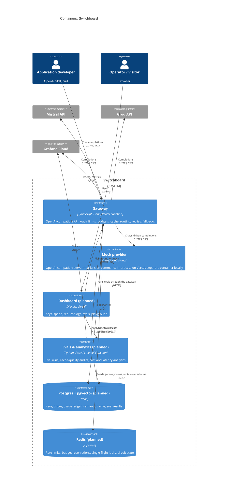

# C4 level 2: containers

The deployable pieces of Switchboard and how they talk to each other.

## Local equivalents

`docker compose up` runs the same containers locally, with pgvector, Redis and
`grafana/otel-lgtm` standing in for Neon, Upstash and Grafana Cloud.
