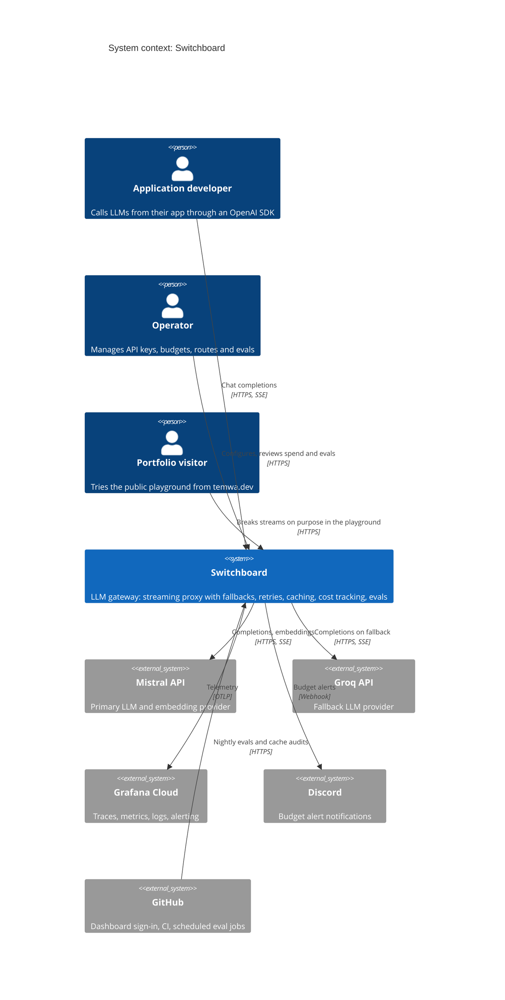

# C4 level 1: system context

Who uses Switchboard and which outside systems it depends on.

**Built in Week 1:** the gateway path from developer to Mistral, Groq and the mock provider.
Everything else on this diagram is planned; see [ROADMAP.md](../../ROADMAP.md).
