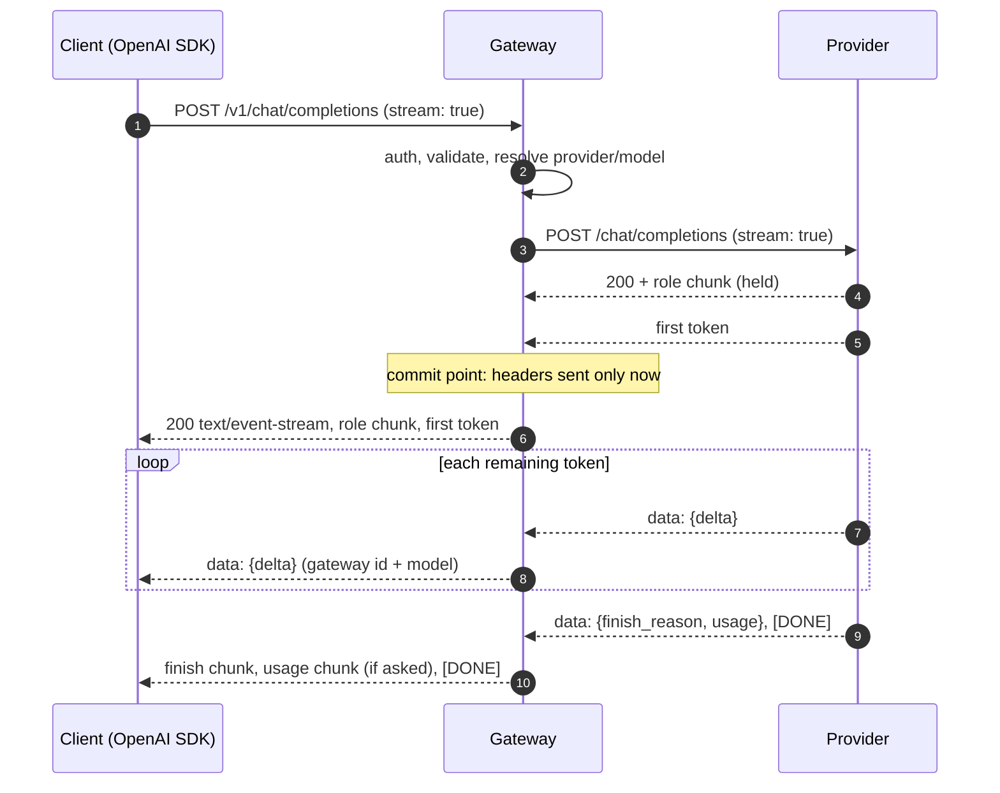
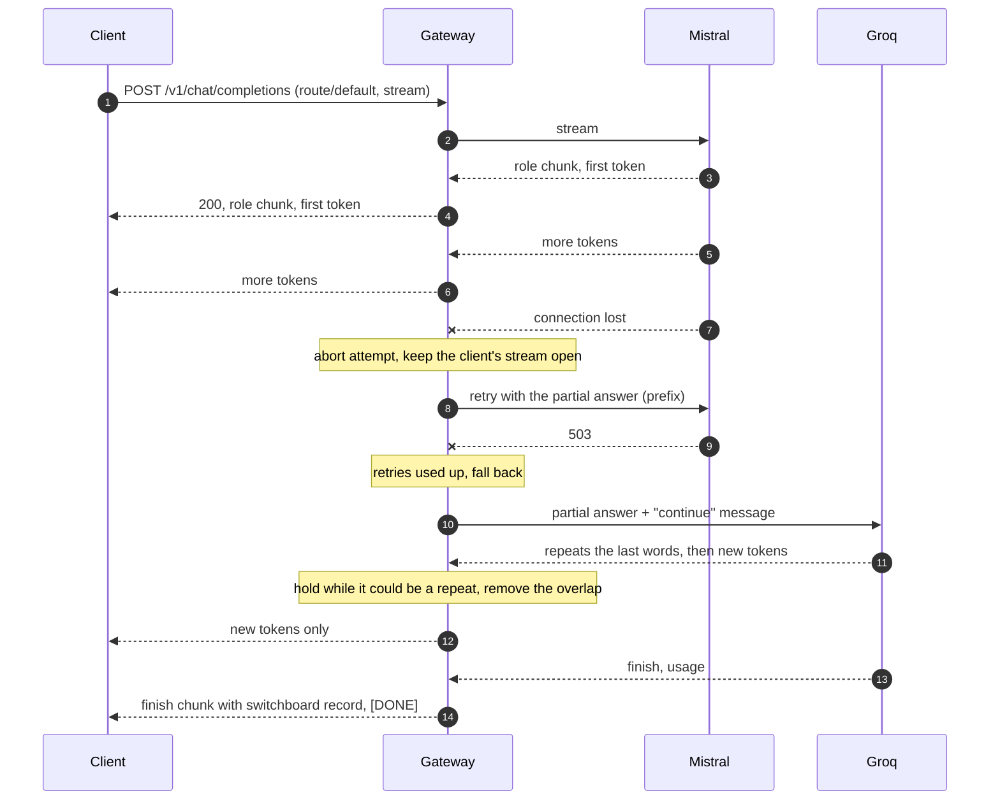

# Design doc: the Switchboard gateway

| | |
|---|---|
| **Status** | Draft. Week 1 is built; later sections describe planned work |
| **Author** | Gregory Temwa Odete |
| **Last updated** | 2026-11-02 |

## 1. Context

Applications that call LLMs directly each re-implement the same things, usually badly: retries,
switching provider when one is down, caching, tracking spend per customer, and tracing.
Switchboard puts those concerns in one place, a gateway that speaks the OpenAI Chat Completions
API, so any OpenAI SDK can use it by changing the base URL.

## 2. Goals and non-goals

**Goals**
- Drop-in compatibility with the OpenAI SDK for chat completions, streaming and non-streaming.
- Survive upstream failures *during* a stream, not just before it (Week 2).
- Correct caching: never serve one tenant's answer to another, never cache a broken answer (Week 4).
- Accurate cost per API key, including the cost of failed attempts (Week 3).
- Every request traceable end to end with OpenTelemetry GenAI conventions (Week 5).
- Runs entirely on free tiers.

**Non-goals**
- Hosting models. Switchboard only proxies.
- Every OpenAI endpoint. Chat completions and models first; embeddings in Week 4.
- `n > 1`. Multiple choices multiply cost and complicate failover; rejected with 400.

## 3. API

| Method | Path | Notes |
|---|---|---|
| `GET` | `/healthz` | No auth |
| `GET` | `/v1/models` | Lists `provider/model` ids |
| `POST` | `/v1/chat/completions` | OpenAI request body; `stream: true` returns SSE |

Models are addressed as **`provider/model`**, for example `mistral/mistral-small-latest` or
`mock/mock-lorem`. The prefix selects the adapter; the rest goes upstream unchanged. A model named
this way gets retries but no fallback, because the client asked for that model specifically.

Named **routes** expand to a fallback chain. `route/default` is Mistral then Groq, keeping only the
providers with an API key. `route/demo` is two instances of the mock provider. The real route
never falls back to the mock, so a client can't be answered with lorem ipsum during an outage.
Routes are defined in code until the `routes` table arrives in Week 3.

Responses carry `x-request-id`, `x-switchboard-provider` and `x-switchboard-model`, which name
what actually served the request, and `x-switchboard-attempts`. The response body keeps the model
the client asked for. Errors use OpenAI's error shape,
`{"error": {"message", "type", "code"}}`, so SDKs raise their usual exception classes.

## 4. Architecture

See the [C4 context](../architecture/c4-context.md) and [container](../architecture/c4-container.md)
diagrams. Inside the gateway:

```
HTTP (Hono) → auth → body limit → validate (zod) → resolve "provider/model"
           → attempt loop: adapter.stream() → deadlines → hold until committed
           → SSE writer  or  aggregator
```

### 4.1 The adapter contract

```ts
interface ProviderAdapter {
  name: string;
  models: readonly string[];
  stream(call: ProviderCall): AsyncIterable<StreamEvent>;
}

type StreamEvent =
  | { type: "start"; upstreamId; model }
  | { type: "delta"; content?; toolCalls? }
  | { type: "usage"; inputTokens; outputTokens }
  | { type: "finish"; reason };
```

Two decisions shape everything after this:

1. **Adapters always stream upstream**, even when the client asked for a single JSON response;
   the gateway aggregates. There is exactly one code path to make resilient, measure and bill.
2. **Failures are thrown, not emitted.** An adapter throws a `ProviderError` with a `kind`
   (`rate_limited`, `server`, `timeout`, `network`, `protocol`, `bad_request`, `auth`). The kind,
   not the HTTP status, drives what happens next, because many failures (a dropped connection,
   malformed JSON) have no status at all. Errors reported inside a `200` stream are classified
   from their `type` and `code`, so a rate limit or a bad request is still treated as one.

One adapter, `openAICompatible`, covers Mistral, Groq and the mock provider. Provider quirks are
configuration: Mistral needs `seed` renamed to `random_seed` and rejects `stream_options`; Groq
only sends usage when asked through `stream_options.include_usage`.

### 4.2 The commit point

The gateway sends nothing to the client until an attempt reaches the commit point. A streaming
request commits at its first content or tool-call token; a role chunk alone does not count, so
an upstream that opens a stream and dies immediately is still retried invisibly. A non-streaming
request commits when the attempt completes, because the client sees nothing until then, so a
failure anywhere in it can be retried.

- **Before the commit point**, a failure goes to the attempt loop (section 4.3). If no attempts
  are left it becomes a proper HTTP status: 429 (with `Retry-After`) for rate limits, 504 for
  timeouts, the upstream status for client errors, 502 otherwise.
- **After the commit point**, the status line is already `200`. A failure is reported in-band as
  a final SSE `data: {"error": ...}` event, with no `[DONE]`. The OpenAI SDK turns this into an
  `APIError` while iterating. Under the `resume` policy this only happens once nothing can
  complete the answer (section 4.4).



### 4.3 The attempt loop

Each failed attempt is classified by its `ProviderError.kind`. `bad_request` and `auth` never
retry, since the same request would fail the same way. Everything else retries until one of these
stops it:

| Limit | Default | Notes |
|---|---|---|
| Attempts | 3 | Including the first |
| `Retry-After` | 5 s | A provider asking for longer is not waited for; its 429 goes to the client |
| Total deadline | 120 s | Covers every attempt and backoff; a wait that would outlast it is skipped |
| Retry budget | 10% of requests, plus 1 per second | Per provider, over a 10 s window |

The wait between attempts is exponential backoff with full jitter (a uniform pick up to a ceiling
that doubles from 200 ms to 4 s), or `Retry-After` if that is longer.

**Fallback.** A route tries each provider in turn, and the limits above apply per provider except
the total deadline, which is shared. Attempts are numbered across the whole chain.

| Failure | Provider with a fallback ready | Last provider in the chain |
|---|---|---|
| `bad_request` | Stop: the request would fail anywhere | Stop |
| `auth` | Fall back: the credentials are this provider's problem | Stop |
| `rate_limited`, `timeout` | Fall back at once: retrying soon won't help | Retry |
| `server`, `network`, `protocol` | Retry, then fall back | Retry |

A fallback doesn't draw on the retry budget, since it loads a different provider, and it has no
backoff. Spending the budget on one provider moves the request to the next. If the whole chain
fails, the client gets the last provider's error.

**Deadlines.** An attempt fails with `timeout` if its first token takes over 20 s, measured from the
start of the attempt, or if 10 s pass between events after that. Timers race each read rather
than relying on the adapter to notice an abort, so a stuck upstream can never hold a request
open.

**Retry budget.** Three attempts per request would triple the load on a provider that is
already failing. The budget caps retries as a share of recent traffic, with a small reserve so a
quiet gateway can still retry. It is per-instance for now; a shared one in Redis comes with the
circuit breaker.

Responses report the attempts used in `x-switchboard-attempts`.

### 4.4 Mid-stream failures

[ADR 4](../adr/0004-mid-stream-failure-policy.md) has the reasoning. Each request runs under one of
two policies: `resume` (the default) or `abort`. `MID_STREAM_POLICY` sets the default, and
`x-switchboard-mid-stream` overrides it for a request.



A resume is an ordinary attempt, using the rules in section 4.3 and sharing the total deadline. It
doesn't happen after a tool call has been sent, for structured output, or after a `bad_request`.
The finish chunk of a resumed stream records what happened, because the headers left too early to:

```json
"switchboard": { "resumed": true, "resumes": 1, "provider": "groq",
                 "model": "groq/llama-3.3-70b-versatile", "attempts": 3 }
```

A failure after the finish chunk is ignored: the answer is complete, and at worst the trailing
usage is missing. A stream that ends with no finish at all counts as a failure, so a broken answer
can never look complete.

### 4.5 Client disconnects

Each request owns an `AbortController`, and each attempt derives its own signal from it, so a
deadline can stop one attempt without ending the request. The request's controller is aborted
when the client's request signal fires or when the response stream is cancelled. That stops the
upstream generation and its cost, cuts short any backoff, and prevents further attempts.

### 4.6 Output formatting

The gateway re-emits chunks under **its own** response id and the model name the client sent.
Upstream ids would change mid-response once fallbacks exist. Usage is held back and sent as the
OpenAI-style trailing chunk (`choices: []`) only if the client set
`stream_options.include_usage`. Streamed tool-call fragments are stitched together by `index`
when aggregating a non-streaming response.

## 5. Security (Week 1)

- Bearer-token auth from configuration, compared as SHA-256 digests with `timingSafeEqual`.
  Week 3 replaces this with hashed per-org keys in Postgres.
- 1 MiB request body limit.
- Provider keys live only in server environment variables.
- The mock provider's chaos header is forwarded only to the mock adapter.

## 6. Testing

- Unit: SSE parser (line endings, byte-level splits, multi-byte characters), error
  classification, chaos parsing.
- Gateway behaviour against the in-process mock: every failure mode before and after the commit
  point, tool-call aggregation, client cancellation aborting upstream.
- Attempt loop: backoff, retry budget, each of the three deadlines, an adapter that ignores its
  abort, and disconnects during an attempt and during backoff. The mock's `fail_attempts` switch
  limits faults to the first N attempts, so retries can be tested end to end.
- Resume: the mock produces the same answer for the same prompt and can continue from a partial
  one, so a resumed answer must match an uninterrupted one byte for byte, including with injected
  overlap (`resume_overlap`) and across providers.
- **Compatibility:** the official `openai` SDK against a real listening gateway: models, plain
  and streamed completions, usage chunks, `RateLimitError`, mid-stream `APIError`, and abort.

## 7. Open questions

- **Week 3:** per-key budgets require a cost estimate before the call; the maximum is
  `max_tokens` × output price, but most requests omit `max_tokens`.
