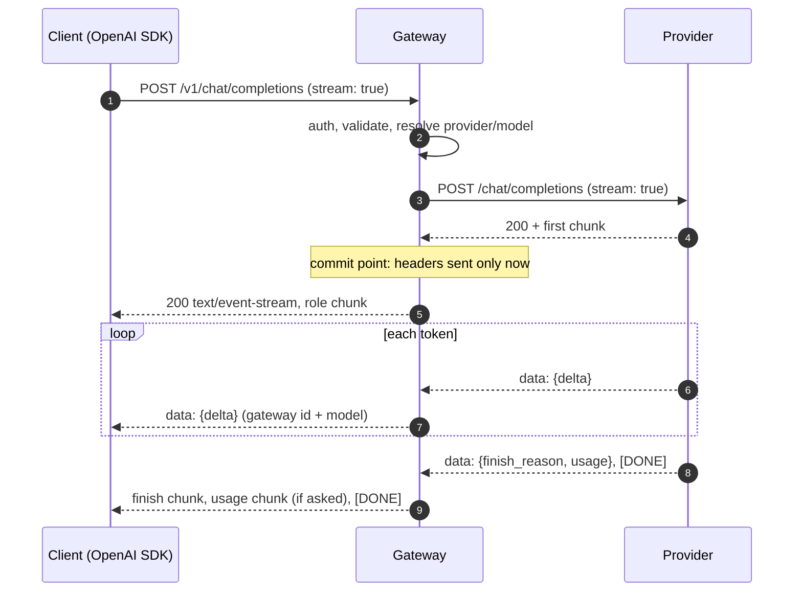

# Design doc: the Switchboard gateway

| | |
|---|---|
| **Status** | Draft. Week 1 is built; later sections describe planned work |
| **Author** | Gregory Temwa Odete |
| **Last updated** | 2026-10-11 |

## 1. Context

Applications that call LLMs directly each re-implement the same things, usually badly: retries,
switching provider when one is down, caching, tracking spend per customer, and tracing.
Switchboard puts those concerns in one place, a gateway that speaks the OpenAI Chat Completions
API, so any OpenAI SDK can use it by changing the base URL.

## 2. Goals and non-goals

**Goals**
- Drop-in compatibility with the OpenAI SDK for chat completions, streaming and non-streaming.
- Survive upstream failures *during* a stream, not just before it (Week 2).
- Correct caching: never serve one tenant's answer to another, never cache a broken answer (Week 4).
- Accurate cost per API key, including the cost of failed attempts (Week 3).
- Every request traceable end to end with OpenTelemetry GenAI conventions (Week 5).
- Runs entirely on free tiers.

**Non-goals**
- Hosting models. Switchboard only proxies.
- Every OpenAI endpoint. Chat completions and models first; embeddings in Week 4.
- `n > 1`. Multiple choices multiply cost and complicate failover; rejected with 400.

## 3. API

| Method | Path | Notes |
|---|---|---|
| `GET` | `/healthz` | No auth |
| `GET` | `/v1/models` | Lists `provider/model` ids |
| `POST` | `/v1/chat/completions` | OpenAI request body; `stream: true` returns SSE |

Models are addressed as **`provider/model`**, for example `mistral/mistral-small-latest` or
`mock/mock-lorem`. The prefix selects the adapter; the rest goes upstream unchanged. Week 2 adds
named routes (for example `route/default`) that expand to a fallback chain.

Responses carry `x-request-id` and `x-switchboard-provider`. Errors use OpenAI's error shape,
`{"error": {"message", "type", "code"}}`, so SDKs raise their usual exception classes.

## 4. Architecture

See the [C4 context](../architecture/c4-context.md) and [container](../architecture/c4-container.md)
diagrams. Inside the gateway:

```
HTTP (Hono) → auth → body limit → validate (zod) → resolve "provider/model"
           → adapter.stream()  ──►  internal StreamEvent iterator
           → prime (wait for first event)
           → SSE writer  or  aggregator
```

### 4.1 The adapter contract

```ts
interface ProviderAdapter {
  name: string;
  models: readonly string[];
  stream(call: ProviderCall): AsyncIterable<StreamEvent>;
}

type StreamEvent =
  | { type: "start"; upstreamId; model }
  | { type: "delta"; content?; toolCalls? }
  | { type: "usage"; inputTokens; outputTokens }
  | { type: "finish"; reason };
```

Two decisions shape everything after this:

1. **Adapters always stream upstream**, even when the client asked for a single JSON response;
   the gateway aggregates. There is exactly one code path to make resilient, measure and bill.
2. **Failures are thrown, not emitted.** An adapter throws a `ProviderError` with a `kind`
   (`rate_limited`, `server`, `timeout`, `network`, `protocol`, `bad_request`, `auth`). The kind,
   not the HTTP status, drives what happens next, because many failures (a dropped connection,
   malformed JSON) have no status at all.

One adapter, `openAICompatible`, covers Mistral, Groq and the mock provider. Provider quirks are
configuration: Mistral needs `seed` renamed to `random_seed` and rejects `stream_options`; Groq
only sends usage when asked through `stream_options.include_usage`.

### 4.2 The commit point

The gateway does not send response headers until the adapter yields its first event (`prime`).

- **Before the first event**, a failure becomes a proper HTTP status: 429 (with `Retry-After`)
  for rate limits, 504 for timeouts, the upstream status for client errors, 502 otherwise.
  In Week 2 this window is where retries and fallbacks are invisible to the client.
- **After the first event**, the status line is already `200`. A failure is reported in-band as
  a final SSE `data: {"error": ...}` event, with no `[DONE]`. The OpenAI SDK turns this into an
  `APIError` while iterating. Week 2 adds the `resume` policy here.



### 4.3 Client disconnects

Each request owns an `AbortController` for its upstream call. It is aborted when the client's
request signal fires or when the response stream is cancelled, so a client that leaves stops
the upstream generation and the cost with it.

### 4.4 Output formatting

The gateway re-emits chunks under **its own** response id and the model name the client sent.
Upstream ids would change mid-response once fallbacks exist. Usage is held back and sent as the
OpenAI-style trailing chunk (`choices: []`) only if the client set
`stream_options.include_usage`. Streamed tool-call fragments are stitched together by `index`
when aggregating a non-streaming response.

## 5. Security (Week 1)

- Bearer-token auth from configuration, compared as SHA-256 digests with `timingSafeEqual`.
  Week 3 replaces this with hashed per-org keys in Postgres.
- 1 MiB request body limit.
- Provider keys live only in server environment variables.
- The mock provider's chaos header is forwarded only to the mock adapter.

## 6. Testing

- Unit: SSE parser (line endings, byte-level splits, multi-byte characters), error
  classification, chaos parsing.
- Gateway behaviour against the in-process mock: every failure mode before and after the commit
  point, tool-call aggregation, client cancellation aborting upstream.
- **Compatibility:** the official `openai` SDK against a real listening gateway: models, plain
  and streamed completions, usage chunks, `RateLimitError`, mid-stream `APIError`, and abort.

## 7. Open questions

- **Week 2:** timeouts (time to first token, stall between tokens, total), retry budget, and the
  mid-stream `resume` policy. See the roadmap.
- **Week 3:** per-key budgets require a cost estimate before the call; the maximum is
  `max_tokens` × output price, but most requests omit `max_tokens`.
- Should the commit point move later than the first event, for example to the first content
  token, so that a role chunk followed by an immediate failure is still retryable invisibly?
